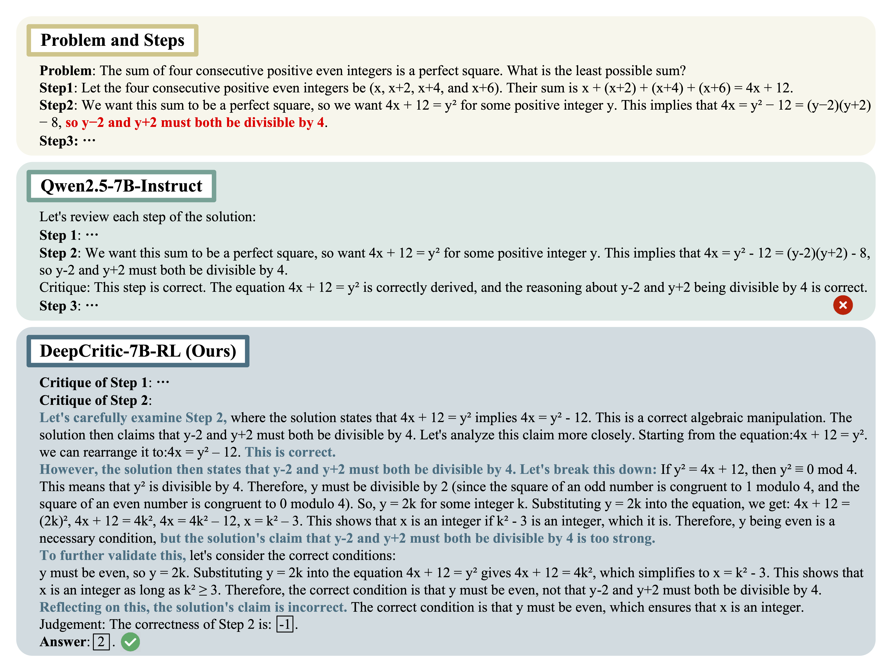

# DeepCritic: Deliberate Critique with Large Language Models
[](https://arxiv.org/abs/2505.00662)

 We propose **DeepCritic**, a novel framework to enable LLM critics to produce deliberate and in-depth critiques for mathematical solutions. 

<div style="display: flex; justify-content: center; flex-wrap: wrap;">
    
</div>

---------

## News
- [2025.06.24] We adjusted the RL recipes on the same RL training data (adding KL loss, adding entropy loss, increasing rollout_n to 16, setting top_p to 1.0), resulting in two stronger RL variants: **DeepCritic-7B-RL1.5-PRM800K** and **DeepCritic-7B-RL1.5-Numina**. We have released the model weights on HuggingFace.
- [2025.05.18] We upload the code for RL data generation via Monte Carlo sampling-based correctness estimation.
- [2025.05.17] We upload the SFT and RL models, along with the curated SFT and RL data.
- [2025.05.11] We upload the code for deliberate critique generation, supervised fine-tuning and evaluation.
- [2025.05.01] We release our paper on [arxiv](https://arxiv.org/pdf/2505.00662).

## Evaluation Results

| Model | MR-GSM8K | PRM800K | GSM8K | MATH | OlympiadBench | Omni-Math | Avg. |
|-------|----------|---------|-------|------|-----------------|------------|------|
| ***Process Reward Models (PRMs)*** ||||||||
| Math-Shepherd-PRM-7B | 61.8 | 21.7 | 48.2 | 27.1 | 20.5 | 16.3 | 32.6 |
| RLHFlow-PRM-8B-Mistral | 66.6 | 25.2 | 50.9 | 32.0 | 13.8 | 15.7 | 34.0 |
| RLHFlow-PRM-8B-DeepSeek | 44.8 | 18.5 | 32.3 | 34.2 | 16.0 | 18.3 | 27.4 |
| Qwen2.5-Math-7B-PRM800K | 70.8 | 55.6 | 70.5 | 64.7 | 50.0 | 42.7 | 59.7 |
| ***Large Language Models, served as Critique Models*** ||||||||
| LLaMA3.1-8B-Instruct | 31.6 | 16.0 | 23.8 | 18.9 | 18.3 | 17.2 | 21.0 |
| Qwen2.5-7B-Instruct | 48.1 | 25.6 | 42.9 | 36.6 | 25.5 | 25.9 | 34.1 |
| Qwen2.5-Math-7B-Instruct | 35.6 | 19.4 | 23.1 | 22.0 | 9.2 | 10.4 | 20.0 |
| DeepSeek-R1-Distill-Llama-8B | 69.4 | 55.7 | 65.0 | 62.7 | 58.4 | 51.7 | 60.5 |
| DeepSeek-R1-Distill-Qwen-7B | 77.9 | 57.4 | 71.9 | 69.9 | 56.4 | 46.8 | 63.4 |
| LLaMA3.1-70B-Instruct | 72.4 | 34.1 | 72.5 | 47.6 | 41.0 | 36.8 | 50.7 |
| Qwen2.5-72B-Instruct | 72.6 | 45.3 | 72.2 | 52.4 | 41.9 | 43.1 | 54.6 |
| Qwen2.5-Math-72B-Instruct | 73.6 | 41.0 | 68.6 | 48.5 | 28.6 | 27.3 | 47.9 |
| GPT-4o | 69.7 | 45.9 | 72.1 | 57.3 | 50.5 | 53.4 | 58.2 |
| ***Our Critique Models*** ||||||||
| DeepCritic-7B-SFT | 67.1 | 48.0 | 59.2 | 61.2 | 46.0 | 43.0 | 54.1 |
| DeepCritic-7B-RL-Numina | 77.2 | 55.9 | 70.7 | 65.9 | 57.6 | 53.5 | 63.5 |
| DeepCritic-7B-RL1.5-Numina | 78.6 | 57.1 | 75.2 | 70.0 |  54.3 | 51.2 | 64.4 |
| DeepCritic-7B-RL-PRM800K | 77.3 | 60.1 | 74.0 | 72.9 | 60.9 | **57.2** | 67.1 |
| DeepCritic-7B-RL1.5-PRM800K | **79.1** | **62.7** | **80.0** | **73.2**  | **62.9** |  56.7 |  **69.1** |


## Models and Data
|           Name         |   |
|------------------------|:------|
|   DeepCritic-7B-SFT       | [hf model](https://huggingface.co/Keven16/DeepCritic-7B-SFT)   |
| DeepCritic-7B-RL-PRM800K | [hf model](https://huggingface.co/Keven16/DeepCritic-7B-RL-PRM800K) |
| DeepCritic-7B-RL-Numina | [hf model](https://huggingface.co/Keven16/DeepCritic-7B-RL-Numina) |
| DeepCritic-7B-RL1.5-PRM800K | [hf model](https://huggingface.co/Keven16/DeepCritic-7B-RL1.5-PRM800K) |
| DeepCritic-7B-RL1.5-Numina | [hf model](https://huggingface.co/Keven16/DeepCritic-7B-RL1.5-Numina) |
| SFT Data | [hf dataset](https://huggingface.co/datasets/Keven16/DeepCritic-4.5K) | 
| RL Data |  [hf dataset](https://huggingface.co/datasets/Keven16/DeepCritic-RL-Data)  |

## Installation
- For critique generation and supervised fine-tuning, you can follow the instructions in [alignment-handbook](https://github.com/huggingface/alignment-handbook) to create the environment. We also provide the pre-built [Docker image](https://hub.docker.com/layers/wenkyang/self-align/v24.05/images/sha256-21fb05198c783f3ece7485609b3064ffcce46bc23b152f3f6892dce41fee122f) for further usage. However, when use the Docker, please update the ``transformers`` version accordingly:
```bash
pip uninstall transformers -y
pip install transformers>=4.45.2
```

- For RL training, our code is mainly based on [verl](https://github.com/volcengine/verl), so you can directly follow the instrucions in [verl](https://github.com/volcengine/verl) to build the environment. Alternatively, you can use the pre-built [Docker image](https://hub.docker.com/layers/verlai/verl/vemlp-th2.4.0-cu124-vllm0.6.3-ray2.10-te1.7-v0.0.3/images/sha256-3c79824d78e1f039dd459f8020c82cf28d8b178134f6250b21c273cfd4dfea1d).


## Data
The evaluation data is in the ``data/`` directory. The raw data for SFT and RL data generation can be downloaded from [here](https://drive.google.com/file/d/1eeg-2X9-PSRTMJvBQv7sAmpzxZ8KXLxg/view?usp=sharing).

## Deliberate Critique Generation
The code for generating SFT data is in the ``Critique_Generation/`` directory. Please download the processed [PRM800K](https://github.com/openai/prm800k) data from [here](https://drive.google.com/file/d/1eeg-2X9-PSRTMJvBQv7sAmpzxZ8KXLxg/view?usp=sharing), and put it in the ``data/prm800k/``. We provide example commands in ``scripts/run_critique_gen.sh``, you can simply run the following command to generate the SFT data:
```bash
sh scripts/run_critique_gen.sh
```

## Supervised Fine-Tuning
Our SFT code is mainly based on [alignment-handbook](https://github.com/huggingface/alignment-handbook). After creating the deep critique data, please convert it to the required format for training:
```python
python3 sft/convert_data.py
```

Then, you can perform SFT by running
```bash
sh sft/run_sft.sh
```

## Reinforcement Learning
### RL Data Generation
We provide the code for RL data generation via Monte Carlo sampling-based correctness estimation in the ``Critique_Generation/`` directory. The example commands are in ``scripts/run_rollout.sh``.
```bash
sh scripts/run_rollout.sh
```

### RL Training
Our RL training is mainly based on the open-source training platform [verl](https://github.com/volcengine/verl).

## Evaluation
Our evaluation code is mainly based on [ProcessBench](https://github.com/QwenLM/ProcessBench), and you can run the following script to perform evaluation on critique models:
```bash
sh scripts/run_eval.sh
```

## Acknowledgments
Our code is mainly based on [alignment-handbook](https://github.com/huggingface/alignment-handbook), [verl](https://github.com/volcengine/verl), and [ProcessBench](https://github.com/QwenLM/ProcessBench). We sincerely thank them for their open-sourcing!

## Citation
If you find our work helpful, please kindly cite as
```bibtex
@article{yang2025deepcritic,
  title={DeepCritic: Deliberate Critique with Large Language Models},
  author={Yang, Wenkai and Chen, Jingwen and Lin, Yankai and Wen, Ji-Rong},
  journal={arXiv preprint arXiv:2505.00662},
  year={2025}
}
```